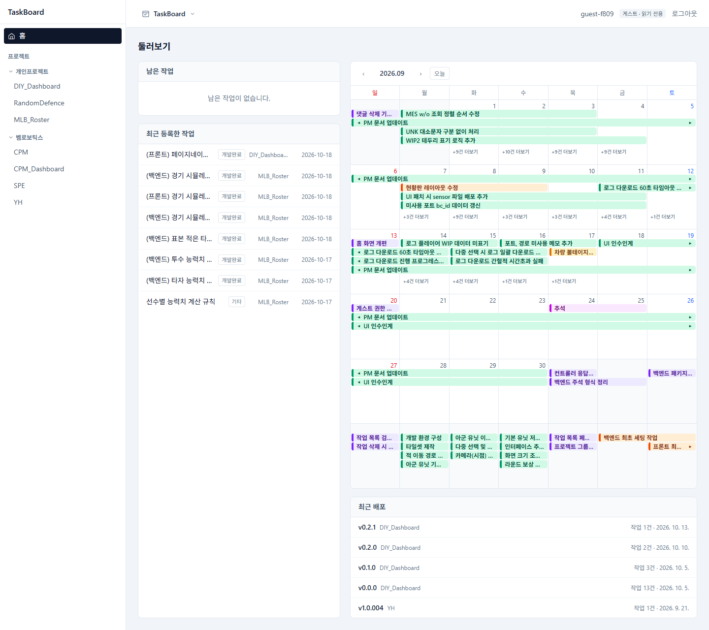
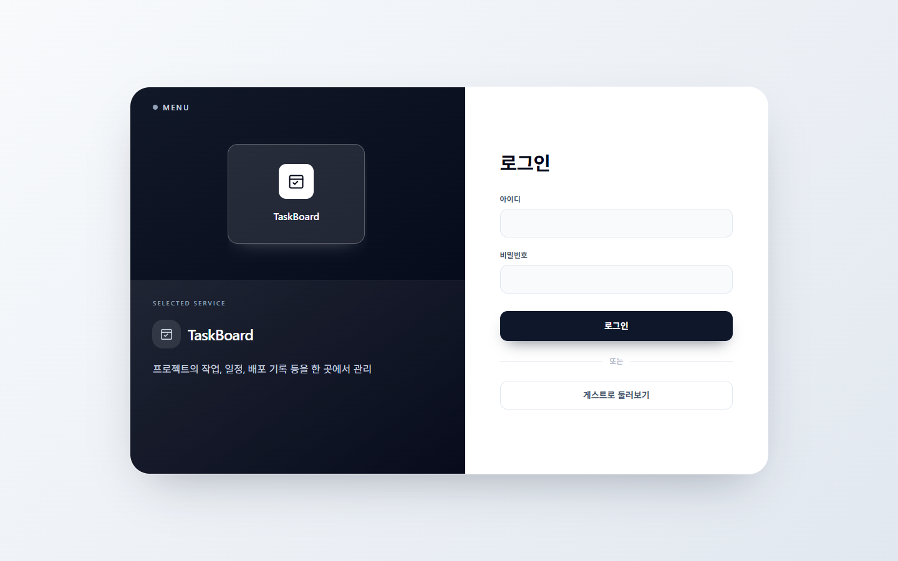
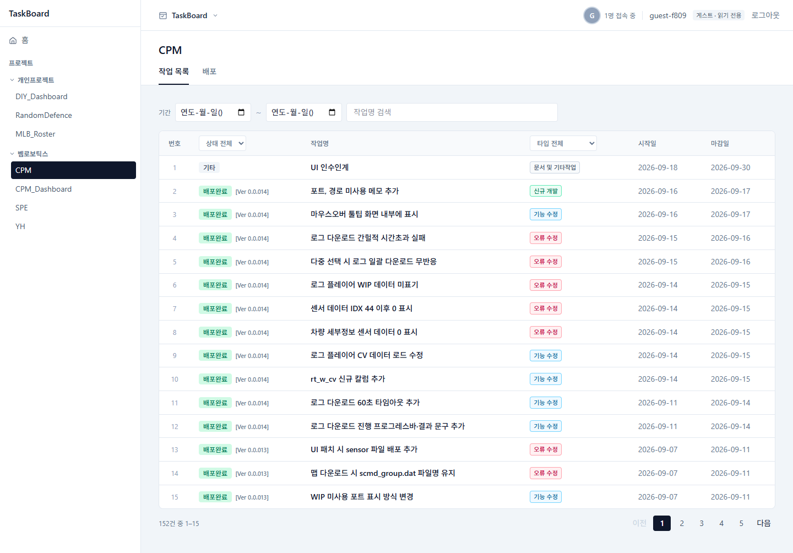
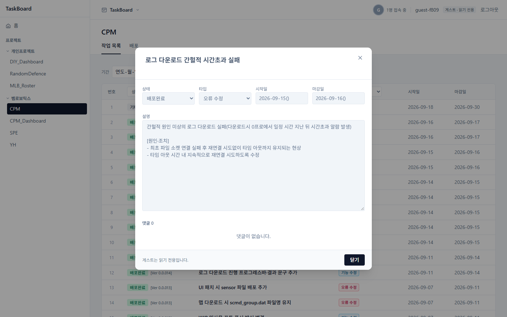
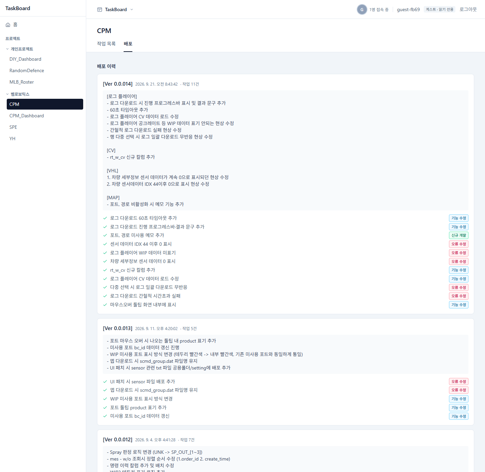
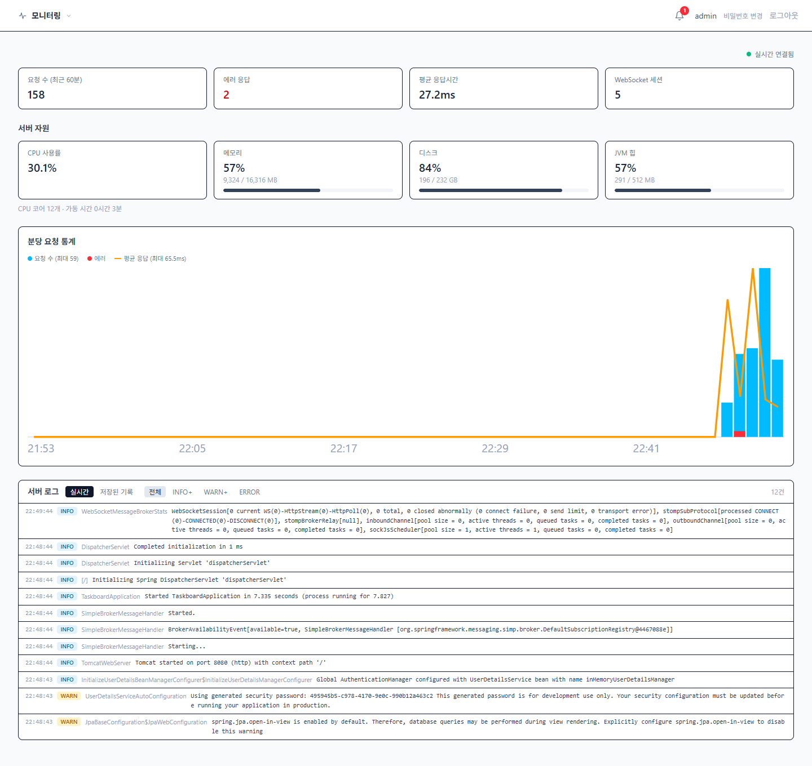
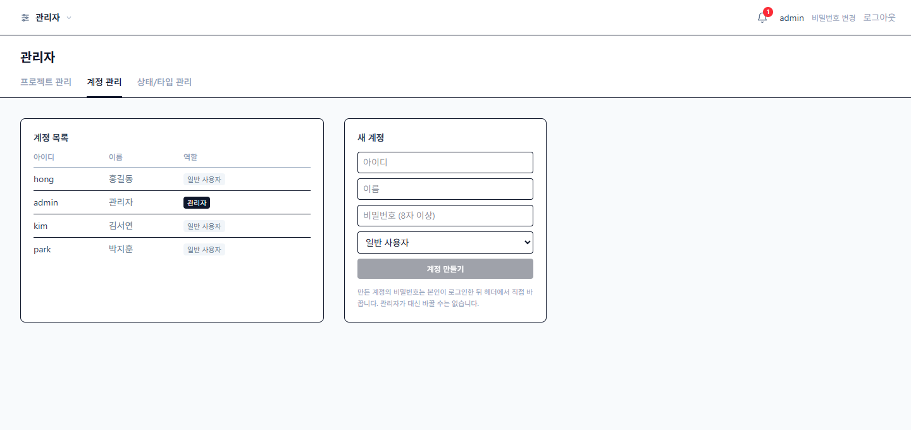
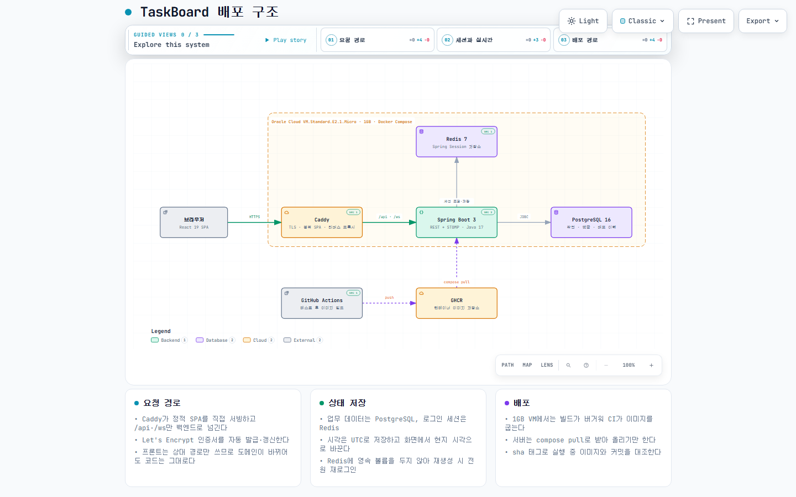

# TaskBoard

작업 · 일정 · 배포(릴리즈)를 한곳에서 관리하는 작업 관리 툴

> **라이브 데모** — https://129-225-171-106.sslip.io
> 로그인 화면의 **게스트로 둘러보기**로 계정 없이 읽기 전용으로 둘러볼 수 있습니다.

 

## 주요 기능

| 기능 | 설명 |
|---|---|
| **작업 관리** | 상태·유형·기간 관리, 유형별 색상 배지, 저장 버튼 없이 즉시 저장 |
| **작업 찾기** | 작업명·기간·상태·유형 검색, 30개씩 페이지 나누기 |
| **프로젝트 그룹** | 사이드바에서 프로젝트를 그룹별로 묶고 접기·펼치기 |
| **홈** | 작업 기간과 개인 일정을 보여주는 월간 캘린더, 남은 작업, 최근 배포 |
| **실시간 반영** | 접속자 표시, 작업·댓글 변경을 다른 접속자 화면에 즉시 반영 |
| **배포 관리** | 완료된 작업을 묶어 버전 발행, 패치노트 작성, 배포 취소 |
| **게스트 로그인** | 계정 없이 읽기 전용으로 둘러보기 |
| **관리자 앱** | 프로젝트·그룹·멤버·계정 관리, 작업 상태·유형 설정 |
| **모니터링 앱** | 요청·에러·응답시간, 서버·백엔드·DB 자원, 실시간 로그 |

<b>화면 더 보기</b>

 

**로그인**

**작업 목록**

**작업 상세**

**배포**

**모니터링**

**계정 관리**

 

## 아키텍처

> 인터랙티브 버전: [docs/architecture.html](docs/architecture.html) (내려받아 브라우저로 열기)

- **쓰기는 REST, 전파는 WebSocket** — 변경은 커밋이 끝난 뒤에만 STOMP로 브로드캐스트
- **단일 오리진** — Caddy가 정적 파일을 직접 서빙하고 `/api`·`/ws`만 백엔드로 전달 (CORS 불필요)
- **세션은 Redis** — 백엔드를 재배포해도 로그인 유지
- **빌드는 CI에서만** — GitHub Actions가 이미지를 만들어 GHCR에 올리고, 서버는 받아서 실행만 함

 

## 기술 스택

| 영역 | 사용 기술 |
|---|---|
| **프론트엔드** | React 19 · TypeScript · Vite · Tailwind CSS · TanStack Query · STOMP.js |
| **백엔드** | Java 17 · Spring Boot 3 · Spring Security · Spring Session · WebSocket(STOMP) |
| **데이터** | PostgreSQL 16 · Redis 7 (세션) |
| **인프라** | Docker Compose · Caddy · GitHub Actions · GHCR · Oracle Cloud |
| **테스트** | JUnit 5 · Mockito · MockMvc · H2 (백엔드 98건) |

 

## 문서

- [PATCHNOTE.md](PATCHNOTE.md) — 버전별 변경 내역
- [DEPLOY.md](DEPLOY.md) — 서버 준비, 배포·운영 절차, HTTPS 설정, 인스턴스 이전
